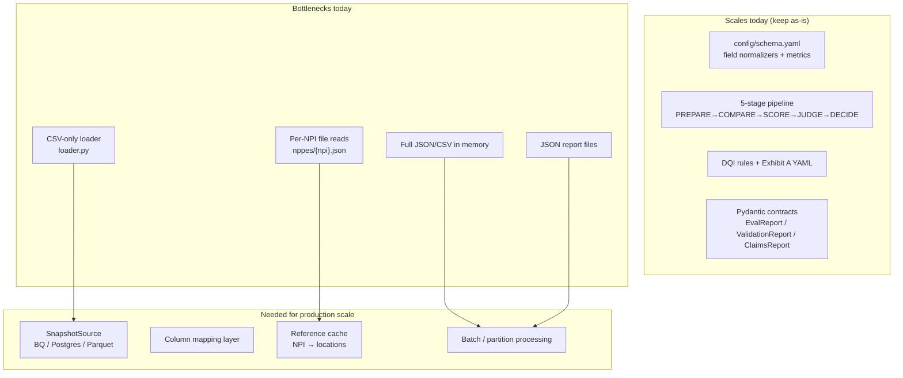

# Framework Scalability Assessment & Path Forward

## Short answer

| Mode | Scalable by design? | Works on new data today? | Ready for BQ/Postgres or lakhs of rows? |
|------|---------------------|--------------------------|----------------------------------------|
| **Release Evaluation** | Yes — delta-only pipeline, config-driven schema | Yes — any two snapshots with matching columns | **Almost** — needs DB ingest + column alias layer; core stages unchanged |
| **Data Quality (DQI)** | Yes — rules are deterministic and config-driven | **Yes** — new roster JSON will surface new findings if rules cover the gap type | **No yet** — loads full roster in memory + one NPPES/detail file read per NPI |
| **Claims Explorer** | Yes — Exhibit A lookup is O(1); checks are per-row | **Yes** — new claims file + cached NPPES/Candor will produce new diagnoses | **No yet** — full claims file in memory + N+1 file reads per unique NPI |

The **framework logic scales**; the **current ingest and I/O layer does not**. That is intentional for the POC — you built demo-friendly offline paths first.

---

## What scales vs what does not (today)



---

## 1. Release Evaluation — BigQuery / Postgres

### What already works

The release pipeline in [`src/candor_qa/pipeline.py`](src/candor_qa/pipeline.py) is **source-agnostic after PREPARE**. It only needs two normalized DataFrames with columns defined in [`config/schema.yaml`](config/schema.yaml):

- Join key: `npi`
- Compared fields: `name`, `phone`, `address`, `zip`, `state`, `specialty`, `insurance_accepted`, etc.

[`docs/ARCHITECTURE.md`](docs/ARCHITECTURE.md) already documents the production path: CSV → partitioned Parquet/SQL → same stage contracts.

[`EvidenceProvider`](src/candor_qa/stage3_score/evidence.py) is a protocol — swap `JsonEvidenceProvider` for a DB/Parquet provenance sidecar without changing SCORE/JUDGE/DECIDE.

### What you need to add

**A. SnapshotSource protocol** (new `src/candor_qa/sources/snapshots.py`):

```python
class SnapshotSource(Protocol):
    def load(self, schema: SchemaConfig) -> pd.DataFrame: ...
```

Implementations:
- `CsvSnapshotSource` — wraps existing [`load_snapshot()`](src/candor_qa/stage1_prepare/loader.py)
- `PostgresSnapshotSource` — `SELECT ... FROM table WHERE snapshot_date = :d`
- `BigQuerySnapshotSource` — same via `google-cloud-bigquery` or export-to-parquet step

**B. Column mapping config** (new `config/column_map.yaml`):

Map your warehouse column names to canonical schema names:

```yaml
# Example: Postgres prod table → schema.yaml
mappings:
  provider_npi: npi
  full_name: name
  practice_phone: phone
  svc_address_line1: address
  # ...
```

Apply mapping in PREPARE **before** normalize/dedupe. After mapping, the pipeline is identical.

**C. CLI flags on `run_evaluation.py`:**

```bash
--baseline-source postgres --baseline-table providers_snapshot --baseline-date 2026-07-24
--candidate-source bigquery --candidate-table candor.providers_daily --candidate-date 2026-07-25
--column-map config/column_map_prod.yaml
```

**D. Optional nightly export path (simplest first step):**

If you do not want live DB connectors immediately:

```
BigQuery/Postgres → export CSV/Parquet (nightly job) → run_evaluation.py (unchanged)
```

This is often enough for release gates at scale (millions of rows exported once, evaluated locally or in CI).

### Scale limits of the pipeline itself

| Scale | Approach |
|-------|----------|
| 400–100K rows | In-memory pandas (current) |
| 100K–10M rows | Partition by NPI prefix; compare per partition; merge `DeltaSummary` |
| 10M+ rows | SQL-based delta (EXCEPT/JOIN on keyed columns) + metrics on full snapshot via SQL aggregates |

The **delta-only design** is the key: you never judge 70M rows — only changed NPIs.

---

## 2. Data Quality — new datasets and new gaps

### Will it find new gaps on new data?

**Yes**, if:

1. You provide Candor search JSON (or equivalent normalized records) for the new roster
2. NPPES reference data exists for those NPIs (cached or fetched)
3. The gap type is covered by a rule in [`src/candor_qa/validation/rules.py`](src/candor_qa/validation/rules.py) + [`config/rules.yaml`](config/rules.yaml)

Rules are **deterministic**, not trained on the 16-provider sample. Running against `sampled100.json` or a new list will produce findings for any provider that triggers DQI-1..9 logic (stale license, PO Box, roster geography mismatch, etc.).

Rules will **not** find gaps you have not encoded (e.g. a new DQI-10 pattern requires adding a rule — same as your manual audit process).

### What breaks at scale (today)

Current flow in [`run_validation.py`](src/candor_qa/validation/run_validation.py):

1. Load **entire** `raw_page1.json` into memory
2. For each provider: read `nppes/{npi}.json` and optionally `details/{npi}.json` — **O(n) disk reads**
3. Write full `ValidationReport` JSON with all findings

For **16 providers**: fine. For **100K providers**: unusable (100K NPPES API/file calls, large memory).

### What to build (priority order)

| Step | Change | Why |
|------|--------|-----|
| 1 | **`ReferenceCache`** — SQLite or Parquet index: `npi → [locations, taxonomy, licenses]` | Eliminates N+1 file/API reads; load once, join many |
| 2 | **`iter_providers(batch_size=500)`** on Candor search source | Stream roster instead of loading all JSON |
| 3 | **Bulk NPPES prefetch** — batch API or nightly dump joined to roster NPIs | Only fetch NPIs you need |
| 4 | **Detail fetch opt-in** — DQI-8 (`recently_moved`) only when rule enabled | Avoid 1 detail API call × every NPI |
| 5 | **Partition global vs per-NPI rules** — DQI-9 dataset stats run once; DQI-1..8 per provider | Already conceptually separate; formalize in `rules.yaml` |
| 6 | **Report sharding** — write findings to Parquet/CSV + summary JSON, not one giant JSON | Dashboard reads summary + paginated findings |

### Candor API at scale (search + detail)

```
list_id=2111 search (paginated) → batch of 500 NPIs
  → join ReferenceCache (NPPES + prior detail)
  → run per-NPI rules
  → append findings to output partition
  → optional detail fetch only for NPIs that failed location/specialty checks
```

No change to rule logic — only ingest orchestration.

---

## 3. Claims Explorer — multiple exhibits, thousands of claims

### What already scales

- **Exhibit A** ([`config/exhibit_a.yaml`](config/exhibit_a.yaml)): adding rows is O(1) lookup; multiple exhibit files = multiple YAML configs or one file with named sections
- **Three-check logic** (map → match → diagnose): embarrassingly parallel per claim row
- **Diagnosis codes**: stable regardless of volume

### What breaks at scale (today)

From [`run_claims.py`](src/candor_qa/claims/run_claims.py):

```python
results = [check_claim_row(row, i, table, cfg) for i, row in df.iterrows()]
# inside check_claim_row → _reference_locations → load_nppes + load_candor_detail PER ROW
```

For 10K claims × 3K unique NPIs = up to **10K redundant file reads** without caching.

Also: **all results stored in one JSON** — a 100K-claim run produces an unusably large dashboard payload.

### What to build

| Step | Change | Why |
|------|--------|-----|
| 1 | **`LocationIndex`** — preload NPPES + Candor details for all NPIs in claims file (distinct `rendering_npi`) | One pass: `unique_npis = df['rendering_npi'].unique()` → bulk load |
| 2 | **Multiple exhibit configs** — `exhibit_a.yaml` with named clients or `--exhibit config/exhibit_a_client_b.yaml` | Supports multiple contract/agreement rule sets |
| 3 | **Chunked processing** — process claims in batches of 5K; write `findings_chunk_*.parquet` | Memory-safe |
| 4 | **Summary-first reports** — persist counts + flagged-only rows in JSON; full results in CSV/Parquet | Dashboard stays fast |
| 5 | **Smarter `flagged` logic** — today many rows flag; at scale only flag anomalies (unmapped, mismatch, likely_matching_bug) | Reduces noise from 422/422 flagged to actionable subset |
| 6 | **Column map for claims** — same pattern as release eval if warehouse column names differ | `rendering_npi` vs `provider_npi` already handled; extend via config |

### Multiple Exhibit A conditions

Two simple patterns (pick one):

**Option A — Multiple YAML files:**
```yaml
# config/exhibits/client_a.yaml
mappings: [...]
# config/exhibits/client_b.yaml
mappings: [...]
```
CLI: `--exhibit config/exhibits/client_a.yaml`

**Option B — Named exhibits in one file:**
```yaml
exhibits:
  default:
    mappings: [...]
  client_b:
    mappings: [...]
```
CLI: `--exhibit-name client_b`

No code change to diagnose logic — only lookup table selection.

---

## Recommended implementation phases

### Phase 1 — Quick wins (no architecture change)

- **Release:** Nightly BQ/Postgres → CSV export → existing `run_evaluation.py` + `column_map.yaml` applied in a thin export script
- **DQI / Claims:** Pre-build NPPES + Candor detail cache directory before run (batch fetch script)
- **Claims:** Add in-memory NPI cache dict in `run_claims.py` (5-line fix, 10× speedup on repeated NPIs)

### Phase 2 — Source abstraction (1–2 weeks)

- `SnapshotSource` for release eval (Postgres + CSV)
- `ReferenceCache` / `LocationIndex` shared by DQI + Claims
- `column_map.yaml` for warehouse → schema mapping
- Chunked report output (summary JSON + findings CSV)

### Phase 3 — Production scale (when needed)

- Partitioned delta compare (NPI prefix shards)
- Bulk NPPES ingest (CMS weekly file → local DB)
- Candor search pagination + conditional detail fetch
- Report store (Postgres/BQ tables instead of JSON files)
- Dashboard reads paginated findings API

---

## Direct answers to your questions

**“If I connect BigQuery/Postgres tomorrow with exact column names for release evaluation?”**

- If columns **match** [`config/schema.yaml`](config/schema.yaml) exactly: export two snapshots → run today, no code change.
- If column **names differ**: add `column_map.yaml` + `SnapshotSource` (Phase 2). Pipeline stages unchanged.
- The release framework **will scale**; only PREPARE ingest needs wiring.

**“Will data quality identify new gaps on new search/detail/NPPES data?”**

- **Yes** for any gap covered by DQI-1..9 rules — re-run `run_validation.py` on new JSON + NPPES cache.
- New gap *types* require new rules (same as adding DQI-10 manually).
- At **large roster size**, you must add ReferenceCache + batching first or runs will be slow/OOM.

**“Claims with multiple exhibits and thousands of records?”**

- **Logic yes**, **I/O no** — add LocationIndex + chunked output + multiple exhibit YAMLs.
- Thousands of claims with ~hundreds of unique NPIs is fine after NPI-level caching.
- Lakhs of claims needs chunked Parquet output and summary-only dashboard view.

---

## Minimal code touchpoints (when you implement)

| File | Change |
|------|--------|
| [`src/candor_qa/stage1_prepare/loader.py`](src/candor_qa/stage1_prepare/loader.py) | Add `load_snapshot_from_df()` + column map apply |
| New `src/candor_qa/sources/snapshots.py` | Postgres/BQ/CSV SnapshotSource |
| New `config/column_map.yaml` | Warehouse → schema aliases |
| [`src/candor_qa/sources/__init__.py`](src/candor_qa/sources/__init__.py) | `ReferenceCache` / `LocationIndex` class |
| [`src/candor_qa/claims/run_claims.py`](src/candor_qa/claims/run_claims.py) | Bulk NPI preload + optional chunk writes |
| [`src/candor_qa/validation/run_validation.py`](src/candor_qa/validation/run_validation.py) | `iter_providers()` + cache-backed rules |
| [`app/views/claims.py`](app/views/claims.py) / [`validation.py`](app/views/validation.py) | Read summary JSON + paginated findings CSV |

**Do not redesign** the three pipelines — add an ingest/cache layer underneath them.
