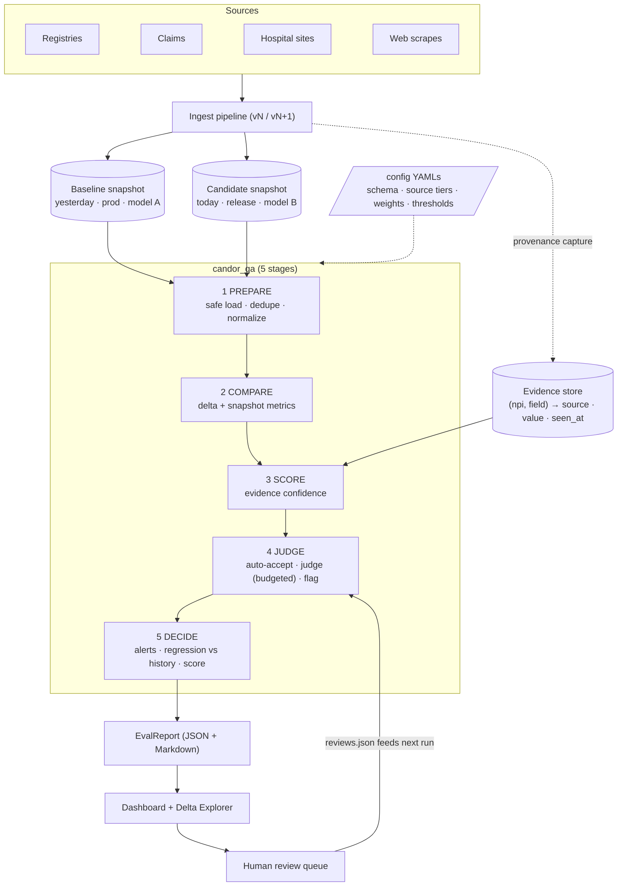
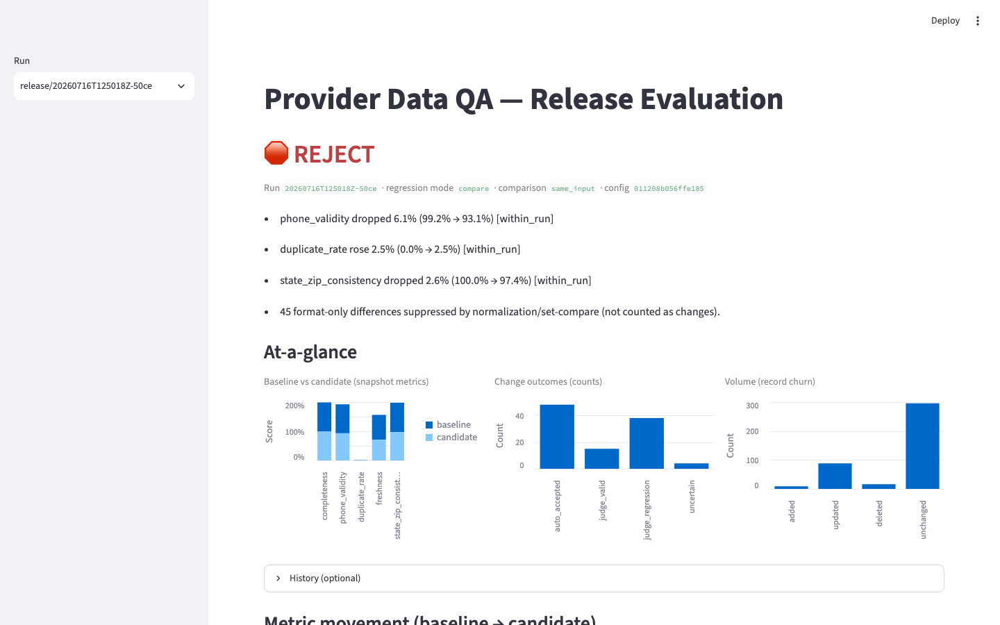
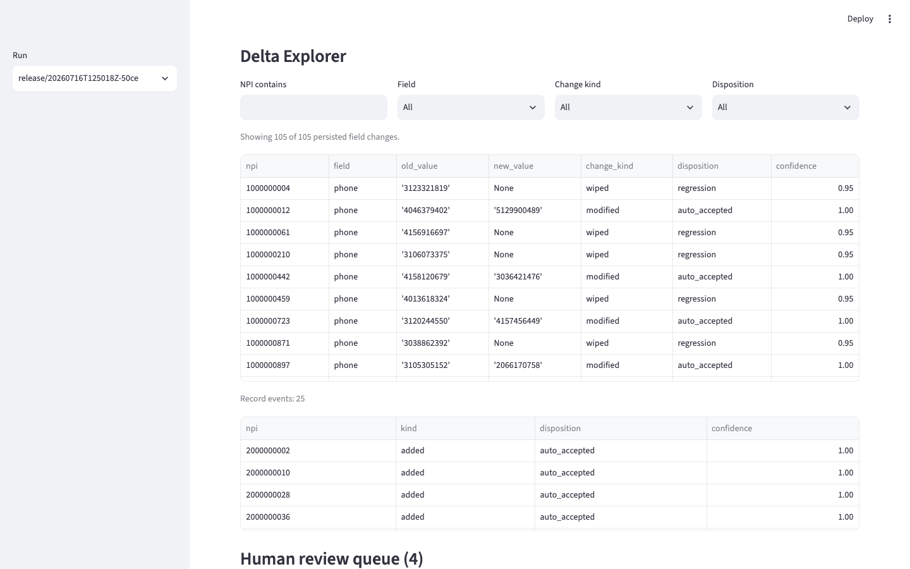
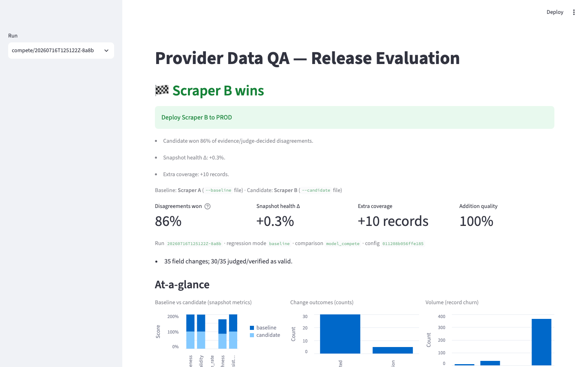
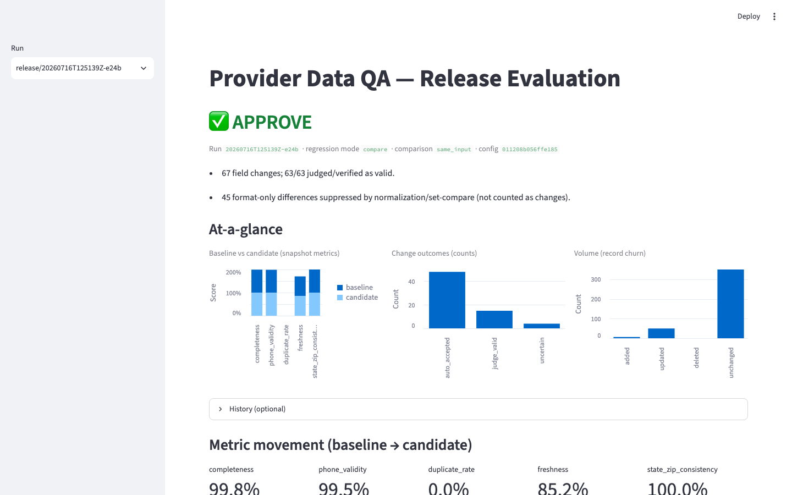

# Candor Provider Data QA — Evaluation Framework POC

**Goal:** automatically answer *"Is the candidate provider snapshot higher quality than the baseline snapshot?"* with a clear **APPROVE / REVIEW / REJECT** decision — **without permanent ground truth**.

Provider data legitimately changes (doctors move, phones change), so a raw dataset diff is not a quality signal and a golden dataset decays. This POC **evaluates only the deltas**, scores changes with **cross-source evidence**, and escalates only the ambiguous band to a **budgeted judge** (mock or real LLM).

**Outputs per run** (written to `data/evaluation_history/{release,compete}/`):

- `EvalReport` **JSON** (powers the dashboard + Delta Explorer)
- **Markdown** report (shareable, decision-first)
- Optional CSV export of persisted deltas via `scripts/export_delta.py`

## Quickstart

**Prereqs:** Python **3.11+**

```bash
python3 -m venv .venv && .venv/bin/pip install -e ".[dev,dashboard]"
.venv/bin/python scripts/generate_sample_data.py

# run one evaluation (writes JSON + Markdown to data/evaluation_history/)
.venv/bin/python scripts/run_evaluation.py \
  --baseline data/providers_v1.csv --candidate data/providers_v2.csv \
  --output data/evaluation_history/release

# (optional) generate the other two report types the dashboard can show
.venv/bin/python scripts/run_validation.py      # Data Quality (DQI) findings
.venv/bin/python scripts/run_claims_check.py     # Claims-to-network mapping

# open the dashboard — sidebar switches between three views (see below)
.venv/bin/streamlit run app/dashboard.py

# tests
.venv/bin/python -m pytest
```

## Dashboard — three views

A sidebar radio switches the Streamlit app between three explorers, each reading
its own report directory under `data/evaluation_history/`:

| View | Answers | Fed by | Highlights |
|---|---|---|---|
| **Release Evaluation** | Is the candidate snapshot better than baseline? | `scripts/run_evaluation.py` → `release/` | Decision banner, at-a-glance charts, **Delta Explorer** (drill to any field change), review queue |
| **Data Quality** | Is this roster internally and cross-source correct? | `scripts/run_validation.py` → `validation/` | DQI-1…9 findings table with severity/NPI/source, filterable, per-DQI counts, known demo providers |
| **Claims Explorer** | Do these claims map to the right networks? | `scripts/run_claims_check.py` → `claims/` | Exhibit-A mapping + address match, reference-data coverage, the six assignment providers (Q1–Q6), flagged claims |

The **Data Quality** and **Claims Explorer** views are new — they validate a live
roster against NPPES/Candor (DQI rules) and reconcile a claims feed against
Exhibit A network mappings, respectively. Each persists an `EvalReport` /
`ValidationReport` / `ClaimsReport` JSON that the dashboard renders.

**Exit codes:** `0` = APPROVE / BASELINE_ESTABLISHED · `1` = REVIEW · `2` = REJECT (drop-in CI gate; example in `docs/ARCHITECTURE.md`).

Note: `pytest` runs evaluations in temp dirs; it **does not** create files under `data/evaluation_history/`. Use `scripts/run_evaluation.py` for dashboard-visible reports.

<details>
<summary>Optional: the 4-run eval script (baseline → reject → compete → approve)</summary>

```bash
# baseline
.venv/bin/python scripts/run_evaluation.py \
  --baseline data/providers_v1.csv --candidate data/providers_v1.csv \
  --regression-mode baseline --output data/evaluation_history/release

# bad release (planted regressions)
.venv/bin/python scripts/run_evaluation.py \
  --baseline data/providers_v1.csv --candidate data/providers_v2.csv \
  --output data/evaluation_history/release

# model competition (two scrapers, same frozen input)
.venv/bin/python scripts/run_evaluation.py \
  --baseline data/dev_a.csv --candidate data/dev_b.csv \
  --comparison-mode model_compete --regression-mode baseline \
  --labels data/labels_compete.json \
  --baseline-label "Scraper A" --candidate-label "Scraper B" \
  --output data/evaluation_history/compete

# clean release
.venv/bin/python scripts/run_evaluation.py \
  --baseline data/providers_v1.csv --candidate data/providers_v2_clean.csv \
  --labels data/labels_clean.json --output data/evaluation_history/release
```

</details>

## Architecture



## What’s covered (and what’s not)

This is a **release gate / competition evaluator**, not a full enterprise data-quality catalog.

- **Covered**
  - **Snapshot health metrics**: completeness, validity (formats + NPI Luhn), uniqueness (duplicate NPIs), freshness, state↔ZIP consistency
  - **Delta evaluation** on shared providers: `change_quality` (verified/judged valid vs regressions)
  - **Record events**: `addition_quality` + deletion review heuristics
  - **Volume churn alerts**: catches silent row drops that rate metrics can’t see
  - **Model competition** (`model_compete`): head-to-head on disagreements with an explicit PROD recommendation
  - **Data Quality validation** (dashboard *Data Quality* view): DQI-1…9 rules over a live roster — license coverage, stale license status, cross-source location conflicts, specialty gaps, facility hygiene, credential coverage — cross-checked against NPPES / Candor detail
  - **Claims-to-network mapping** (dashboard *Claims Explorer* view): NPI + address match, Exhibit A network assignment, and coverage-gap detection over a claims feed
- **Not covered (POC scope)**
  - Domain relevance manifests
  - Entity resolution beyond NPI
  - Judge-based deletion scoring
  - Statistical confidence intervals

## How the score is computed

Overall score is a weighted average over **scoreable** metrics (weight > 0 and not N/A), with **N/A excluded and weights renormalized**:

```
overall_score = Σ (normalized_score × weight) / Σ weight
```

`lower_is_better` metrics (e.g. `duplicate_rate`) use `normalized_score = 1 - score`.

Weights live in config (`config/metrics.yaml`). Full formula + a worked example (with real run numbers): **[`docs/SCORING.md`](docs/SCORING.md)**.

## What we validated (meta-QA outcomes)

The synthetic generator emits ground-truth labels, so we can measure the evaluator itself:

- Planted regressions caught: **38/38**
- Planted invalid additions caught: **3/3**
- False-positive traps surfaced as changes: **0/50**
- Judge precision / recall on regressions (mock judge): **100% / 100%**

## Docs

- **[`docs/ARCHITECTURE.md`](docs/ARCHITECTURE.md)** — stage detail, design rules, CI gate, scaling notes, optional HTTP API
- **[`docs/SCORING.md`](docs/SCORING.md)** — overall score formula, denominator rules, worked example

## Screenshots

<details>
<summary>GIF + screenshots</summary>


| Bad release → REJECT with reasons | Delta Explorer (drill to any record) |
|---|---|
|  |  |

| Model competition → PROD recommendation | Clean release → APPROVE |
|---|---|
|  |  |

</details>

## Project layout

```
config/          schema · source tiers · metrics/weights · judge prompts · zip↔state reference
data/            snapshots (v1, v2, v2_clean, dev_a, dev_b) · labels (ground truth) ·
                 evidence store · evaluation_history/{release,compete}/
src/candor_qa/   contracts.py · config.py · stage1_prepare/ … stage5_decide/ · pipeline.py ·
                 validation/ (DQI rules) · sources/ (Candor + NPPES loaders)
config/          schema · metrics/weights · rules.yaml (DQI) · exhibit_a.yaml (network mappings)
scripts/         run_evaluation.py · run_validation.py · run_claims_check.py ·
                 generate_sample_data.py · reconcile_sources.py · export_delta.py
app/             dashboard.py (3-view router) · views/{validation,claims}.py
api/             FastAPI wrapper
tests/           one file per stage + record events, additions, compete, E2E, validation, claims
docs/            ARCHITECTURE.md · SCORING.md · images/
```
